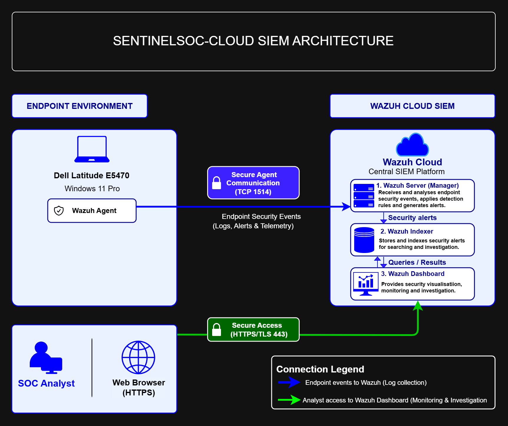

# Architecture and Design

## Overview

This section documents the architecture of the SentinelSOC security monitoring lab. The design connects a Windows endpoint to a Wazuh Cloud SIEM platform and provides secure browser-based access for the SOC analyst.

## Architecture Diagram

**Diagram files**
- `sentinelsoc-architecture.png` — diagram preview
- `SentinelSOC-Cloud-SIEM-Architecture.drawio` — editable diagrams.net source

## Architecture Components

| Component | Purpose |
|---|---|
| Dell Latitude E5470 (Windows 11 Pro) | Monitored endpoint |
| Wazuh Agent | Collects and forwards endpoint security events |
| Wazuh Server (Manager) | Analyses events and generates alerts |
| Wazuh Indexer | Stores and indexes alert data |
| Wazuh Dashboard | Supports security monitoring and investigation |
| SOC analyst and web browser | Provides secure access to the dashboard |

## Communication and Data Flow

1. **Endpoint to Wazuh Server:** The Wazuh Agent forwards endpoint events to the Wazuh Server over TCP port `1514`.
2. **Wazuh Server to Indexer:** The manager analyses events and generates alerts. Alert data is forwarded to the Wazuh Indexer for storage and indexing.
3. **Dashboard to Indexer:** The Wazuh Dashboard queries the Indexer and displays results for monitoring and investigation.
4. **Analyst access:** The SOC analyst accesses the Wazuh Dashboard through a web browser over HTTPS/TLS (TCP port `443`).

## Architecture Objectives

- Define the lab's endpoint and centralised SIEM components.
- Document event collection, alert processing and dashboard query flows.
- Identify the analyst's secure access path.
- Provide a reference for deployment, configuration and testing.

## Implementation Status

- **Architecture design:** Completed
- **Deployment and configuration:** Pending
- **End-to-end validation:** Pending

*This diagram represents the intended lab architecture. Connectivity, services and data flows will be validated during implementation.*

---

Part of the [SOC Analyst Portfolio](https://github.com/Flynn-Okelz/SOC-Analyst-Portfolio).
